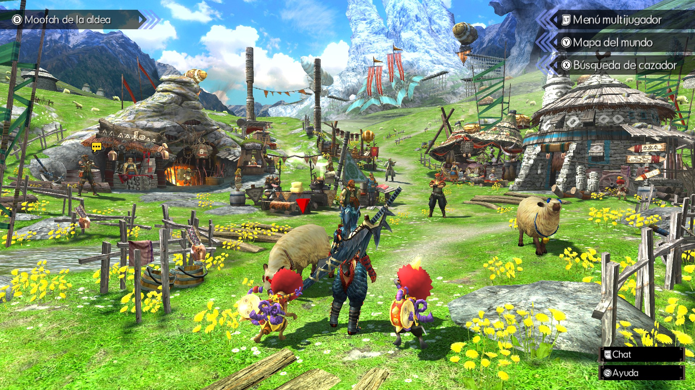
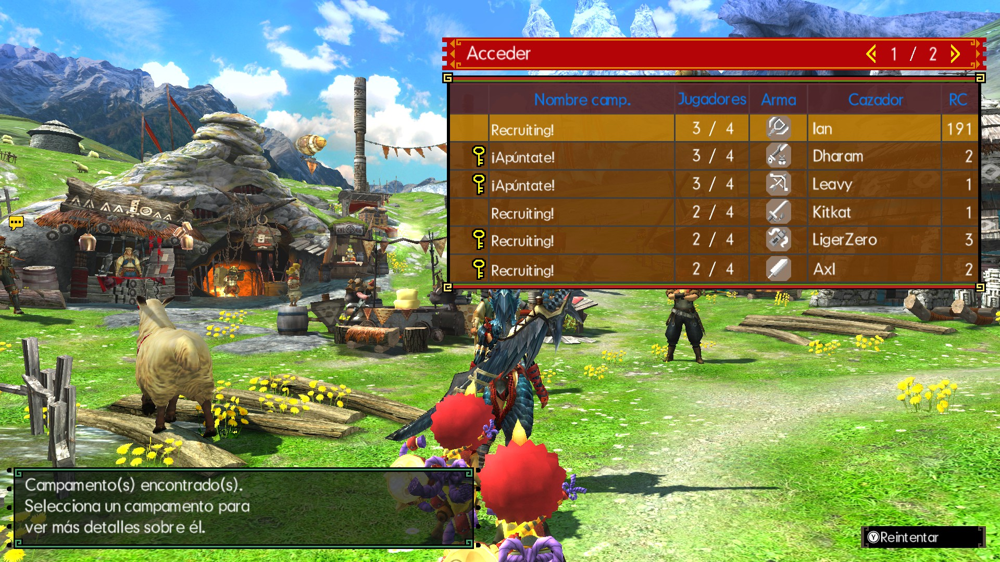
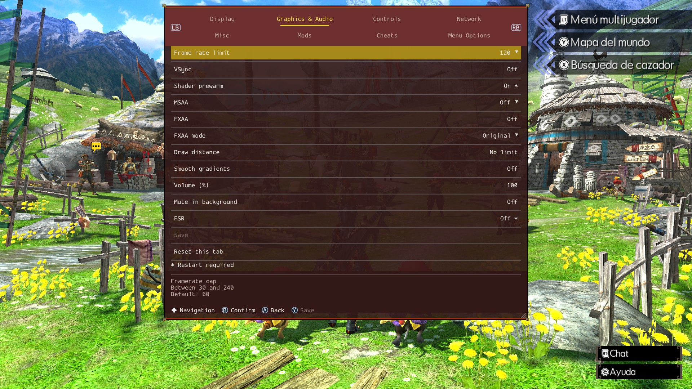

# MHGU Recomp - Linux ARM64

Linux ARM64 adaptation of
[morerokk/MHGURecomp](https://github.com/morerokk/MHGURecomp).
Running the game requires your own complete **MHGU 1.4.0** dump.

## Download

Maintainer-built ARM64 packages, when available, are published in
[Releases](https://github.com/pablovesnine/MHGURecomp/releases).
Download a package and follow [Install](#install); cloning is not required.
To build your own package instead, follow the steps below.

## Maintainer screenshots

The previous maintainer build was tested on **AYN Odin 3** with
[ArmadaOS 20261010](https://github.com/armada-os/armada): the maintainer reports
**120 FPS in Eco mode**, working online multiplayer, and morerokk's custom menu
with all its features working. This newly aligned 0.13.1 revision is not yet device-tested.
The screenshots show that earlier build; the menu's 120 FPS limit is not a benchmark.





## Build

Build on a **Linux x86-64 PC** with Git and working local Docker;
the output is for **ARM64**, not the build PC. Do not replace an existing
working Docker/Moby installation. Run these commands as your normal user.

1. Check the prerequisites:

   ```bash
   git --version
   docker info
   ```

2. Clone this fork:

   ```bash
   git clone --branch master --single-branch https://github.com/pablovesnine/MHGURecomp.git
   cd MHGURecomp
   ```

3. Replace the example path with your dump directory, then build:

   ```bash
   GAME_DIR="/absolute/path/to/MHGU dump/"
   bash tools/build-linux-release.sh --game "$GAME_DIR" --jobs 2
   ```

   The dump must contain `exefs/main`, `exefs/sdk` and the complete `romfs/`.
   Use a dedicated directory: it is mounted read-only, with SELinux labels
   adjusted for Docker. The wrapper uses the tools image matching your
   source commit, or builds that image locally if unavailable.

4. After a successful build, verify the package:

   ```bash
   (cd dist && sha256sum --check SHA256SUMS)
   ```

Output: `dist/LinuxARM64-MHGURecomp.<version>.tar.gz` and `dist/SHA256SUMS`.
The version is the stable upstream release pinned in this checkout, without a
fork suffix. Inspect it with `bash tools/upstream-version.sh`.
Release builds need network access to verify upstream tags and full Git history.
Between releases the version stays unchanged; the exact source SHA is recorded
inside the archive. No dump or package is uploaded automatically.

For later builds, update a clean `master` checkout and repeat steps 3–4:

```bash
git pull --ff-only origin master
```

## Install

Extract into a new directory on your ARM64 Linux device. Copy your dump's
`exefs/` and `romfs/` into its `data/` directory, then run `./mhgurecomp`.
Back up saves before testing an update.

## Maintenance

Published stable upstream releases are checked every six hours; prereleases,
drafts and standalone tags are excluded. Compatible releases enter `master`
only after full ARM64 validation. Normal fork edits run quick checks; full
Docker/QEMU validation is otherwise manual. Protected files stay protected;
conflicts stop integration. Only `master` is permanent. CI never receives game files.

[Maintenance](docs/MAINTAINING.md) ·
[Device requirements and troubleshooting](docs/BUILD-LINUX-ARM64.md) ·
[Settings](docs/SETTINGS_UI.md)

## License

[MIT](LICENSE), with [third-party notices](THIRD_PARTY_NOTICES).
Game files and recompiled game code are not covered by this license.
Not affiliated with Capcom or Nintendo.
